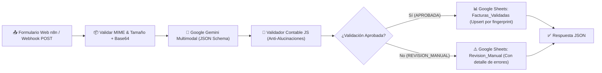

# 🧾 Gestor Automático de Facturas, Recibos y Comprobantes

> **Pipeline de automatización contable con n8n + Google Gemini Multimodal + Motor de Validación Matemática Anti-Alucinaciones.**

[](workflows/n8n-invoice-extractor-gemini.json)
[](prompts/gemini-invoice-extraction.md)
[](src/validator.js)
[](#licencia)

---

## 🎯 ¿Qué resuelve este proyecto?

Extraer datos de facturas y recibos usando únicamente un LLM tiene un riesgo crítico: **las alucinaciones contables** (un dígito mal leído o un subtotal inconsistente puede corromper un reporte financiero).

Este repositorio implementa una arquitectura de **doble capa**:
1. **Extracción Multimodal Estructurada (Google Gemini)**: Recibe imágenes (`JPG`, `PNG`, `WEBP`) o `PDF` vía Formulario Web o Webhook en **n8n** y extrae proveedor, CUIT/RFC/Tax ID, fecha, moneda, subtotal, descuentos, impuestos, propina, total e ítems usando `responseSchema` estricto y `temperature: 0`.
2. **Validación Matemática Determinística (JavaScript)**: Comprueba con código puro que `subtotal - descuento + impuestos + propina = total`, valida la suma de cada ítem, verifica tasas impositivas anómalas, formato de fecha/moneda, confianza mínima y genera un `fingerprint` anti-duplicados antes de guardar en **Google Sheets**.

---

## 🏗️ Arquitectura del Flujo



---

## ✨ Características Principales

- **Visión Multimodal Nativa**: Procesa tanto **PDFs** como **imágenes** directamente sin necesidad de servidores OCR externos.
- **Cero Alucinaciones Silenciosas**: Si `total_extraido` difiere de `total_calculado` en más de `0.02`, el comprobante jamás contamina la hoja principal y se deriva a cuarentena (`Revision_Manual`).
- **Validación de Líneas de Detalle**: Verifica `cantidad × precio_unitario = importe` por cada ítem y compara la sumatoria contra el `subtotal`.
- **Idempotencia Anti-Duplicados**: Calcula un `fingerprint` determinístico para evitar registrar dos veces el mismo comprobante en Google Sheets.
- **100% Testeable Localmente**: Incluye motor modular (`src/validator.js`), CLI de prueba (`src/cli.js`), fixtures realistas y tests unitarios nativos de Node.js (`node:test`) sin dependencias externas.

---

## 📁 Estructura del Repositorio

```text
GESTOR_DE_FACTURAS_AUTOMATIZADO/
├── docker-compose.yml                         # Levanta n8n localmente con variables listas
├── .env.example                               # Plantilla de credenciales y configuración
├── package.json                               # Scripts de test y validación CLI
├── workflows/
│   └── n8n-invoice-extractor-gemini.json      # Workflow completo listo para importar en n8n
├── prompts/
│   └── gemini-invoice-extraction.md           # Prompt de sistema y responseSchema de Gemini
├── src/
│   ├── validator.js                           # Motor determinístico de validación contable
│   └── cli.js                                 # CLI para probar validaciones localmente
├── tests/
│   ├── validator.test.js                      # Suite de tests unitarios (node:test)
│   └── fixtures/                              # Casos de prueba (válidos, alucinaciones, errores)
└── docs/
    ├── architecture.md                        # Reglas anti-alucinación y matriz de códigos
    └── google-sheets-template.md              # Encabezados exactos para Google Sheets
```

---

## 🚀 Puesta en Marcha Rápida

### 1. Clonar y configurar variables de entorno

```bash
git clone https://github.com/<tu-usuario>/GESTOR_DE_FACTURAS_AUTOMATIZADO.git
cd GESTOR_DE_FACTURAS_AUTOMATIZADO
cp .env.example .env
```

Edita `.env` con tu `GEMINI_API_KEY` (obtenida en [Google AI Studio](https://aistudio.google.com/apikey)) y el `GOOGLE_SHEETS_DOCUMENT_ID` de tu hoja de cálculo.

### 2. Preparar Google Sheets

Crea una hoja de cálculo con las pestañas `Facturas_Validadas` y `Revision_Manual` copiando los encabezados definidos en [docs/google-sheets-template.md](docs/google-sheets-template.md).

### 3. Levantar n8n con Docker Compose

```bash
docker compose up -d
```

Abre `http://localhost:5678`, ve a **Workflows → Import from File** e importa [workflows/n8n-invoice-extractor-gemini.json](workflows/n8n-invoice-extractor-gemini.json). Conecta tu credencial OAuth2 de Google Sheets en los dos nodos finales y activa el workflow.

### 4. Probar el Webhook con `curl`

```bash
curl -X POST http://localhost:5678/webhook/extract-invoice \
  -F "data=@./ruta/a/tu-factura.pdf"
```

También puedes abrir la URL pública del nodo **Formulario Web (Subir Comprobante)** y subir un PDF o foto desde el navegador.

---

## 🧪 Pruebas del Motor Anti-Alucinaciones (Sin Docker ni API Key)

Requiere **Node.js 20+** (cero dependencias `npm install` necesarias):

```bash
# Ejecutar toda la suite de tests unitarios
npm test

# Probar una factura válida por CLI
npm run validate -- tests/fixtures/valid-invoice-mx.json

# Probar detección de alucinación matemática (subtotal + impuestos != total)
npm run validate -- tests/fixtures/invalid-math-hallucination.json
```

---

## 📚 Documentación Adicional

- [Arquitectura y Matriz de Reglas Anti-Alucinación](docs/architecture.md)
- [Prompt y JSON Schema de Google Gemini](prompts/gemini-invoice-extraction.md)
- [Plantilla de Columnas para Google Sheets](docs/google-sheets-template.md)

---

## 📄 Licencia

Distribuido bajo licencia **MIT**. Libre para usar, adaptar y ampliar en proyectos personales o comerciales.
